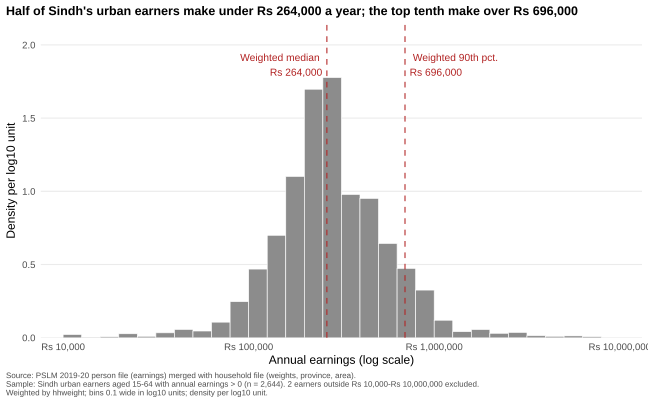
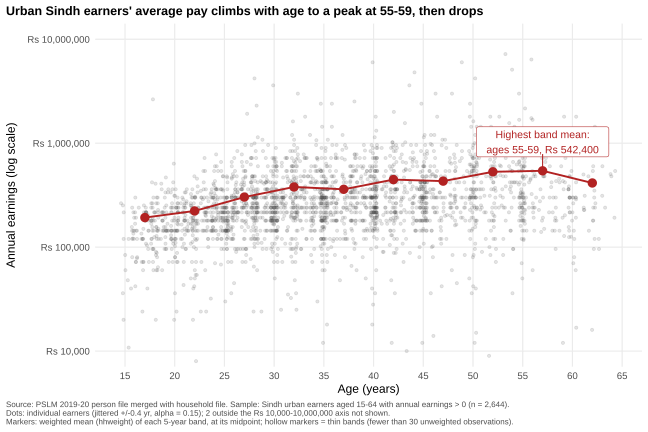

# Name : Ahmad Ali
# ECO346-A1-FA24-BEDS-083 — Assignment 1, Fall 2026 (Section A)

**Name / Reg. no.:** _<your name>_ / FA24-BEDS-0XX  
**Variant:** 3 → **Sindh urban** (`prov_code == 3`, `urban_rural == 2`)  
**Data:** PSLM 2019–20 person + household subset (`data/`). Earners = persons aged 15–64 with `earn_annual > 0`, weighted by `hhweight`.

## How to reproduce (fresh clone, no internet)
```
Rscript scripts/01_default.R
Rscript scripts/02_distribution.R
Rscript scripts/03_relationship.R
python scripts/04_second_language.py
```
Run from the repository root. R needs `readr, dplyr, ggplot2, scales, svglite`; Python needs `pandas, numpy, matplotlib`.

## Figures
| Figure | File |
|---|---|
| Q2 Distribution of earnings | `figures/distribution.svg` |
| Q3 Earnings vs age (redesign) | `figures/relationship.svg` |
| Q4 R default (before) | `figures/default.svg` |
| Q5 Python version of Q3 | `figures/relationship_python.svg` |




## Q2 — The distribution
| Statistic | Value |
|---|---|
| Number of earners | 2,644 |
| Weighted median | Rs 264,000 |
| Unweighted median | Rs 252,000 |
| Weighted 10th percentile | Rs 120,000 |
| Weighted 90th percentile | Rs 696,000 |
| P90 / P10 | 5.80 |
| Excluded (outside Rs 10,000–10,000,000) | 2 |

**What it shows:** Earnings are right-skewed on the log scale, bunched between roughly Rs 150,000 and Rs 400,000 with a long upper tail; the 90th percentile is 5.80 times the 10th. The weighted median is slightly higher than the unweighted one because earners above the unweighted median carry somewhat more survey weight, so weighting shifts the middle of the distribution up.

## Q3 — The relationship
| Age band | Earners (n) | Weighted mean earnings |
|---|---|---|
| 15–19 | 160 | Rs 192,523 |
| 20–24 | 296 | Rs 222,948 |
| 25–29 | 398 | Rs 303,154 |
| 30–34 | 396 | Rs 379,254 |
| 35–39 | 359 | Rs 360,221 |
| 40–44 | 344 | Rs 446,533 |
| 45–49 | 250 | Rs 431,697 |
| 50–54 | 212 | Rs 530,773 |
| 55–59 | 157 | Rs 542,400 |
| 60–64 | 72 | Rs 414,262 |

No band is thin (all n ≥ 30). Weighted mean of 25–29 = **Rs 303,154**; of 45–49 = **Rs 431,697**; highest band = **55–59**.

**Interpretation:** Average earnings rise with age, from about Rs 193,000 for teenagers to over Rs 540,000 at 55–59, consistent with returns to experience and tenure, then fall at 60–64 as people retire or move to lower-paid work. The cloud of individual points is wide at every age: age explains only a small part of earnings differences. The figure cannot tell us how any one person's earnings will change over their life: it is a single cross-section, so age effects and cohort differences are mixed.

## Q4 — The makeover
`figures/default.svg` is `ggplot(data, aes(age, earn_annual)) + geom_point()` with nothing added. Redesign: (1) **log scale** with rupee labels, because earnings are skewed and a linear axis crushes most points at the bottom (perceptual position on a common scale); (2) **jitter plus transparency**, because age is in whole years and many earners share round salaries, so opaque points overplot; (3) **weighted band means joined by a line**, showing the conditional mean that the raw cloud cannot show, with hollow markers for thin bands; (4) **direct annotation and a finding title** instead of a legend and variable names; (5) a minimal theme that removes non-data ink. The default shows the two extreme earners (below Rs 10,000 and above Rs 10,000,000) that my fixed axes cut off.

## Q5 — A second language (Python)
| | 25–29 weighted mean |
|---|---|
| R | Rs 303,154 |
| Python | Rs 303,154 |

The two band tables agree to the rupee (checked by `scripts/04_second_language.py`; tables in `tables/`). One default that differed: `pd.cut` closes intervals on the right, which would put age 20 in 15–19, so I built bands with integer arithmetic; matplotlib also has no jitter and draws minor log ticks, so I added uniform ±0.4 jitter and removed minor ticks.

## Repository layout
```
README.md  data/  scripts/  figures/  slides/FA24-BEDS-0XX.pptx
tables/   (band tables and reported numbers written by the scripts)
```
